# sparkmusic-android — STILLE mobile

The mobile STILLE shell: **Qt Quick / QML** on Android, wired to the real
[`sparkmusic-core`](../core) Rust client. It is the screen-for-screen
mobile translation of [`design/stille-mobile.html`](design/stille-mobile.html):
paper/ink themes, Cormorant + Songti serif typography, hairline Swiss rules, inline
exhibition placards and a landscape desk-clock mode.


Unlike the first design prototype, this build has **no local catalogue and no
simulated transport**:

- the initial 热歌榜, 飙升榜 and 原创榜 are loaded from the NetEase API;
- search, lyrics, play URLs and cover art are live;
- audio plays through **Qt Multimedia** (`MediaPlayer` + `AudioOutput`);
- QR, SMS and Cookie login are real core calls;
- favourites, play history, settings and the session cookie persist in SQLite;
- account playlists and 「我喜欢的音乐」 are loaded after login.

## Screens

| Portrait | Landscape |
|---|---|
| **Player** — live cover/lyrics/audio, horizon scrub, queue drawer | **Desk clock** — 3-column transport / clock / placard |
| **Home** — 策展 / 收藏 / 辑 / 检索 / 设置, live tracks and inline exhibit cards | |
| **Login** — real webplayer QR, SMS passcode, or `__csrf` + `MUSIC_U` cookie | |

| Player | Home | Live search |
|---|---|---|
| 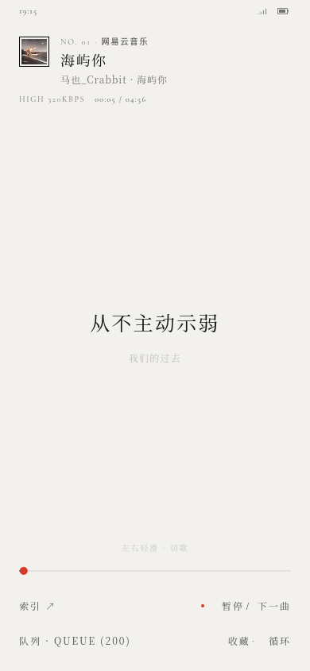 |  | 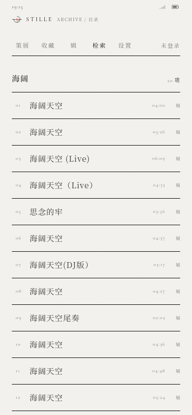 |

| Mini player | Playlist page |
|---|---|
| 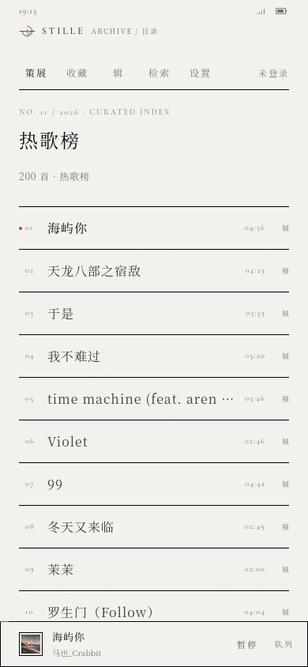 | 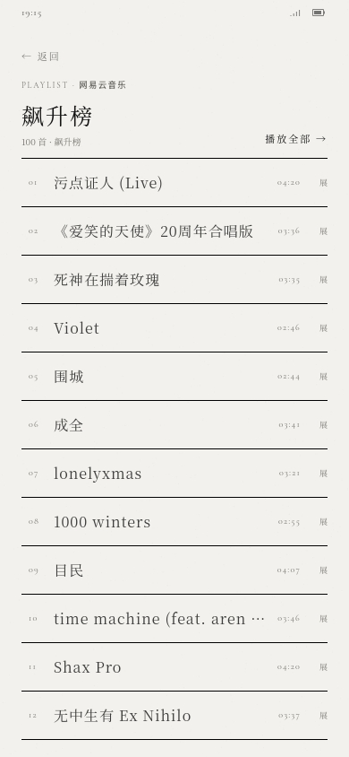 |

| QR login | SMS login | Cookie login |
|---|---|---|
|  | 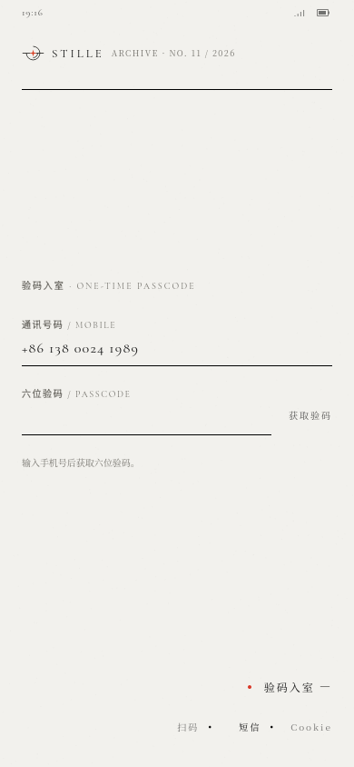 | 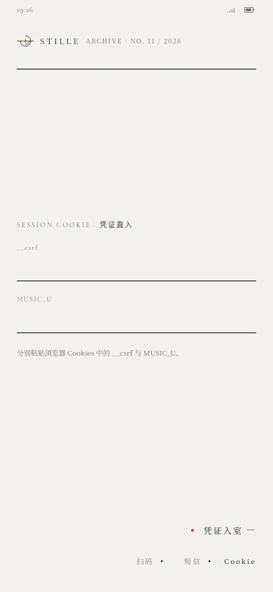 |

| Editions | Queue | Landscape clock |
|---|---|---|
| 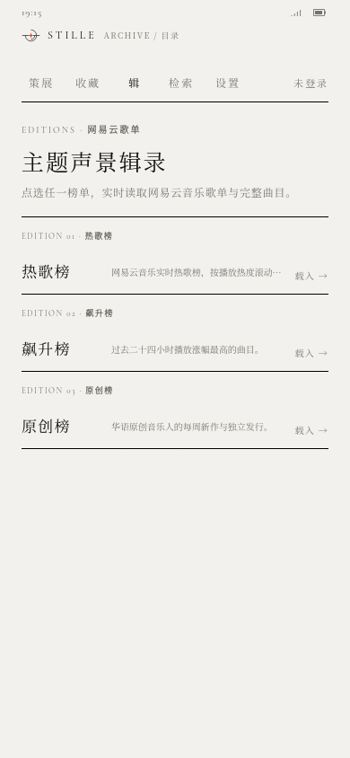 | 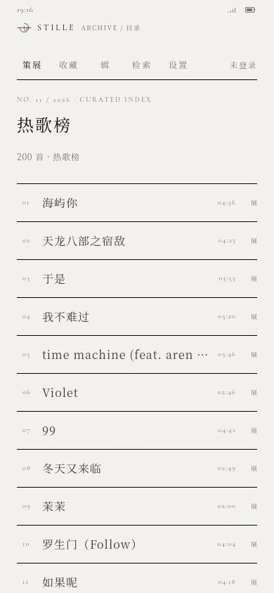 | 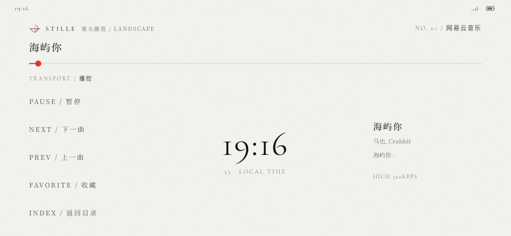 |

| Settings | Grid | Ink |
|---|---|---|
| 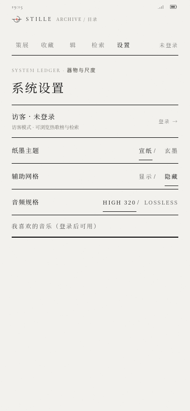 |  | 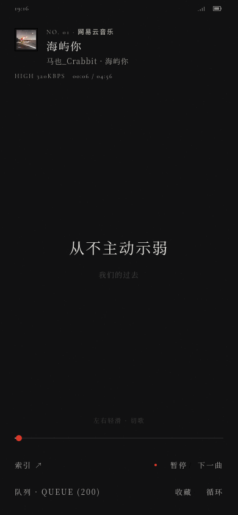 |

## Navigation / 操作逻辑

- **Home is the launch screen.** The player is a destination, not a cold-start
  page. With no current track, the home index is immediately usable.
- **One tap plays.** Tapping a track row sets the visible list as the playback
  queue and opens the player. The inline exhibit is now an explicit trailing
  `展` control (or long-press); its primary action is “播放这首”.
- **The queue follows context.** Search results, local favourites, the home
  hot chart and a pushed playlist each become the queue when tapped. A search
  result outside the hot chart no longer fails silently.
- **Playlist pages preserve context.** 飙升榜 / 原创榜 / account playlists open
  a pushed playlist page; `← 返回` returns to the source tab, not a mutated
  curated tab.
- **Mini player** appears above the paper on every non-player screen: cover,
  title/artist, play/pause and queue. It is a hairline strip, not a Material
  tab bar.
- **Account chip** replaces the old “正在播放” link in the top-right. `未登录`
  opens login; the signed-in nickname opens the account settings. Login returns
  to the source tab.
- **Back stack**: queue → playlist page → player → home → exit. Android back
  and Escape use the same `goBack()` path; the player also accepts a downward
  swipe.
- **AuthView** is no longer linked from settings until a real desktop-auth
  endpoint exists.

## Architecture

```text
QML window (Main.qml, components/)
        │  context properties: core, api
        ▼
CoreAsync (C++/Qt, QThreadPool)          MediaPlayer / AudioOutput
        │  JSON strings, queued signals          │
        ▼                                        ▼
SparkMusicClient (Rust, cxx-qt)  ────────►  NetEase API / CDN
        │
        └─ SQLite: favourites, plays, settings, session, cache
```

- `CoreAsync` runs every blocking core call on Qt's global thread pool and
  emits `playlistReady`, `searchReady`, `songUrlReady`, `lyricReady`,
  `qrKeyReady`, `qrCheckReady`, `loginReady`, … on the GUI thread. The QML
  thread never performs TLS/HTTP.
- `Main.qml` owns the live state machine: catalogue, account, audio, lyrics,
  queue, theme, orientation and view transitions.
- `components/` is the visual vocabulary: `TrackRow`, `PlayerView`,
  `HomeView`, `LoginView`, `AuthView`, `LandscapeView`, `Horizon`, `StampArt`,
  `GridOverlay`, `GrainOverlay`.
- On Android the Rust archive is linked **whole-archive** into
  `libsparkmusic_arm64-v8a.so`; on desktop the host core is added as a CMake
  subproject and linked dynamically.

## Build — desktop preview

Prerequisites: Qt 6.11.2 (Quick, Multimedia), Rust 1.85+, Cargo, a C++20
compiler and Ninja.

```console
$ export PATH="$HOME/.cargo/bin:$PATH"
$ cmake -S . -B build -G Ninja \
    -DCMAKE_CXX_COMPILER=/usr/bin/g++ \
    -DCMAKE_PREFIX_PATH=/path/to/Qt/6.11.2/gcc_64
$ cmake --build build
$ ./build/sparkmusic
```

The desktop host core is built by `core/CMakeLists.txt` through
Cargo. `QMAKE` must point at the Qt qmake if it is not on the CMake target.

Headless stills and audio smoke:

```console
$ QT_QPA_PLATFORM=offscreen ./build/sparkmusic \
    --autoplay --screenshot screenshots/player.png --delay 8000
$ QT_QPA_PLATFORM=offscreen ./build/sparkmusic \
    --view home --section search --query 海阔 \
    --screenshot screenshots/search.png --delay 6000
$ QT_QPA_PLATFORM=offscreen ./build/sparkmusic \
    --landscape --clock --autoplay \
    --screenshot screenshots/landscape.png --delay 8000
```

Flags: `--view player|home|login|auth`, `--section
curated|favorites|editions|search|settings`, `--theme paper|ink`, `--query
<text>`, `--expanded <song-id>`, `--queue`, `--grid`, `--autoplay`, `--clock`,
`--login-mode qr|sms|cookie`, `--landscape`, `--screenshot <path>`,
`--delay <ms>`.

## Build — Android

The Android build uses Qt 6.11.2's `android_arm64_v8a` kit, SDK Platform 36,
Build-Tools 36, NDK **r27c** (`27.2.12479018`), JDK 17 and the Gradle wrapper
that Qt's AGP 9 template downloads.

### 1. Cross-build the Rust core

```console
$ export ANDROID_NDK_ROOT=/path/to/android-sdk/ndk/27.2.12479018
$ export QMAKE=/path/to/Qt/6.11.2/android_arm64_v8a/bin/qmake
$ export RUSTUP_HOME=/path/to/writable/rustup
$ export CARGO_HOME=/path/to/writable/cargo-home
$ rustup target add aarch64-linux-android
$ ./scripts/build-core-android.sh
```

This produces
`../core/target/aarch64-linux-android/release/libsparkmusic_core.a`
and the generated `target/cxxqt/include/` headers.

### 2. Configure and build the APK

```console
$ export JAVA_HOME=/path/to/jdk-17
$ export ANDROID_SDK_ROOT=/path/to/android-sdk
$ export ANDROID_NDK_ROOT=$ANDROID_SDK_ROOT/ndk/27.2.12479018
$ export ANDROID_USER_HOME=/path/to/writable/android-prefs
$ export GRADLE_USER_HOME=/path/to/writable/gradle-home
$ unset ANDROID_SDK_HOME ANDROID_PREFS_ROOT
$ export PATH="$JAVA_HOME/bin:$ANDROID_SDK_ROOT/platform-tools:$PATH"

$ /path/to/Qt/6.11.2/android_arm64_v8a/bin/qt-cmake \
    -S . -B build-android -G Ninja \
    -DQT_HOST_PATH=/path/to/Qt/6.11.2/gcc_64 \
    -DANDROID_ABI=arm64-v8a \
    -DANDROID_PLATFORM=android-35 \
    -DANDROID_SDK_ROOT=$ANDROID_SDK_ROOT \
    -DANDROID_NDK_ROOT=$ANDROID_NDK_ROOT
$ cmake --build build-android --target sparkmusic_make_apk
```

The native platform is `android-35` because NDK r27c caps at API 35; Qt's Java
target SDK is 36. AGP reads **only** `ANDROID_USER_HOME`; setting
`ANDROID_SDK_HOME`/`ANDROID_PREFS_ROOT` to the same path makes AGP abort.
Audio CDN URLs are often `http://…`; the manifest opts into cleartext traffic
for playback only.

### 3. Installable debug APK

```console
$ cd build-android/android-build
$ ./gradlew assembleDebug
$ cp build/outputs/apk/debug/android-build-debug.apk \
     ../../dist/Stille-0.4.1-debug-arm64-v8a.apk
```

The debug APK is built locally to
`dist/Stille-0.4.1-debug-arm64-v8a.apk` but is intentionally **not committed**
(the binary is ~92 MB). Build it with the steps above, then:

```console
$ adb install -r dist/Stille-0.4.1-debug-arm64-v8a.apk
```

For an x86_64 emulator use the `android_x86_64` kit and
`-DANDROID_ABI=x86_64`; compile the core with the matching Rust target.

## Login

- **QR** — `loginQrKey` requests the webplayer-parity code, `qrMatrix` draws it,
  `loginQrCheck` polls every second. 801/802/803/8821 are surfaced in place.
- **SMS** — `sendSmsCode` then `login/cellphone` with `{phone,countrycode,captcha}`
  through the weapi envelope; the account is verified after 200.
- **Cookie** — separate `__csrf` and `MUSIC_U` fields; a full cookie line works
  too. `setCookie` then `nuser/account/get`.
- The session cookie is persisted by the core and reloaded on startup with
  `loadSession`; 退出登录 uses `clearCookies` + `clearSession`.
- Account playlists and the special `specialType == 5` liked playlist are read
  with `user/playlist`.

## Design system — 全衬线

Typography is **all serif**, not a line/sans face:

- Latin: **Cormorant Garamond** Regular / SemiBold.
- Chinese: **STILLE Song** — Noto Serif SC Regular 400, instanced from the
  variable font and renamed to a single Regular family.

The signature stays in the **vector StilleMark** (arc, chord, vermilion
four-point star) and the 1 px rules; type itself is Songti + Cormorant
throughout. Fonts and their OFL notice are in [`fonts/`](fonts).

| Token | Paper | Ink |
|---|---|---|
| canvas | `#F2F1ED` | `#111112` |
| ink | `#141414` | `#E8E6E1` |
| secondary | `#77756F` | `#9E9C96` |
| accent | `#D93829` | `#D93829` |

- Generated 1600 px lockups/wordmarks and the 512 px app icon live in
  [`branding/`](branding).
- 4-column portrait / 8-column landscape hairline grid; 2% paper grain.
- 44 dp minimum text hit targets; horizon drag area 44 dp.
- `Main.qml` switches to landscape automatically from `Screen` dimensions; the
  center column shows the clock for instrumentals or when `--clock` is set.

## Current scope

Real catalogue/search/lyrics/audio/account login are wired. The remaining
design-shell pieces are deliberately local:

- **掌端授权** (`AuthView`) is still the visual desktop-authorization study;
  there is no server endpoint for it yet.
- No background playback/media session, notifications or offline download UI.
- Account playlist management is read-only (open a playlist to play it).
- The debug APK has been built and inspected; no Android device was attached in
  this environment, so on-device screenshots are not included.
