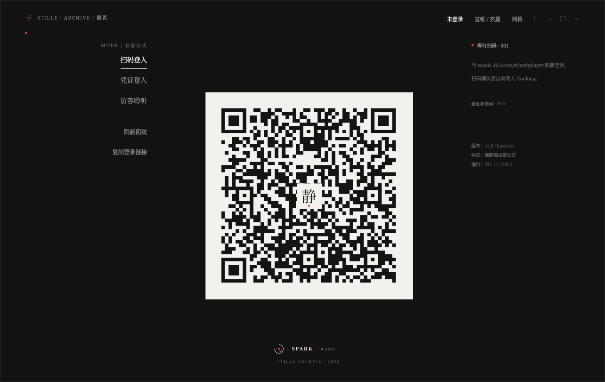

# Branding

Source artwork for the SparkMusic mark and wordmark.

| File | Notes |
|---|---|
| `icon-paper.svg`, `icon-ink.svg` | 128×128 app icons (paper / ink themes) |
| `mark-paper.svg`, `mark-ink.svg` | transparent mark only |
| `wordmark.svg`, `wordmark-ink.svg` | horizontal lockup (`SPARK ✦ MUSIC`) |
| `*.png` | raster renditions used by the app and README |

The app embeds the PNGs through `gui/CMakeLists.txt` (`qt_add_resources`, prefix
`/branding`): the window icon uses `icon-paper.png`, the top bar uses the
theme-matching mark, and the login colophon uses the wordmark.

Regenerate the PNGs after editing an SVG:

```console
$ magick -background none icon-paper.svg -resize 512x512 icon-paper.png
$ magick -background none mark-paper.svg -resize 256x256 mark-paper.png
$ magick -background none wordmark.svg   -resize 1360x256 wordmark.png
```



The mark stays a single vermilion `#D94126` accent on a hairline Swiss grid,
matching the paper/ink palette used by the shell.
