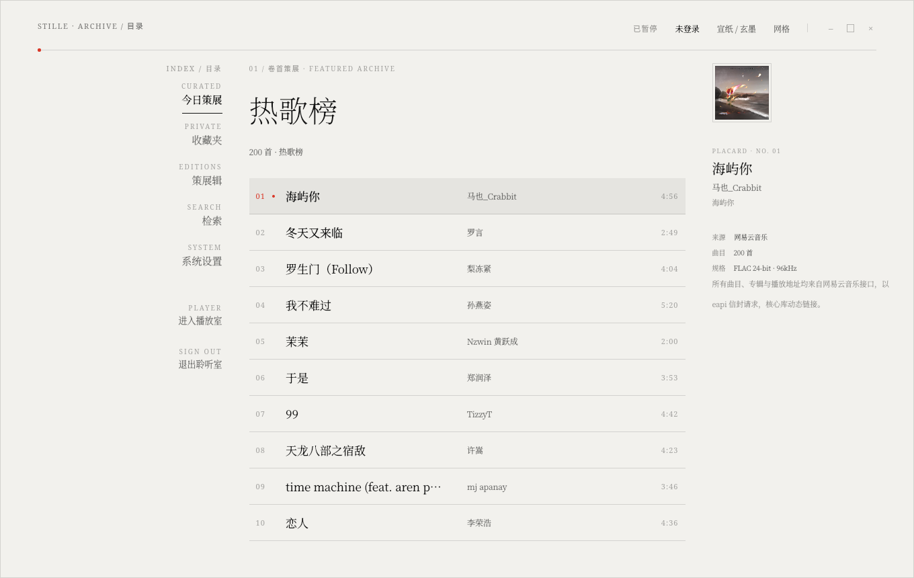
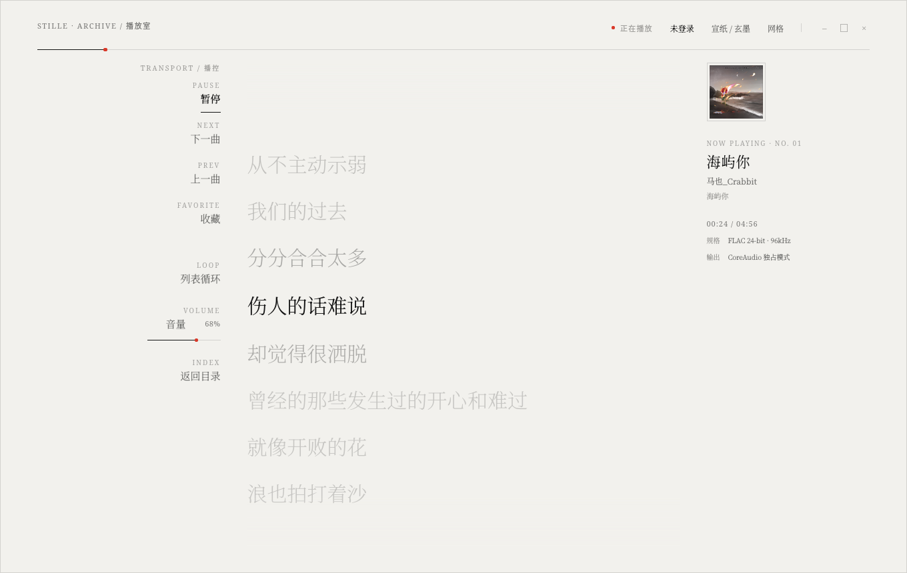
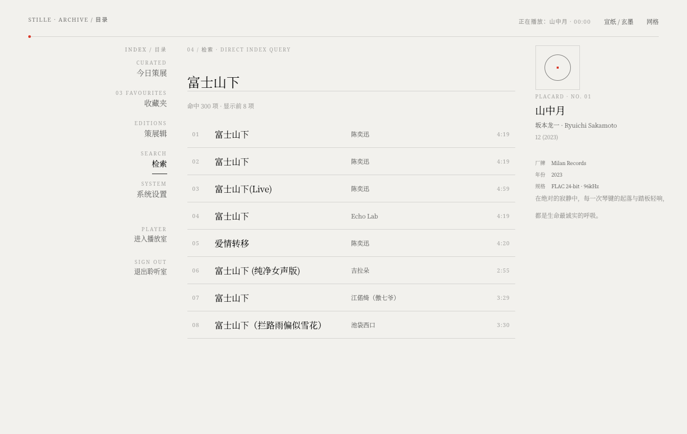
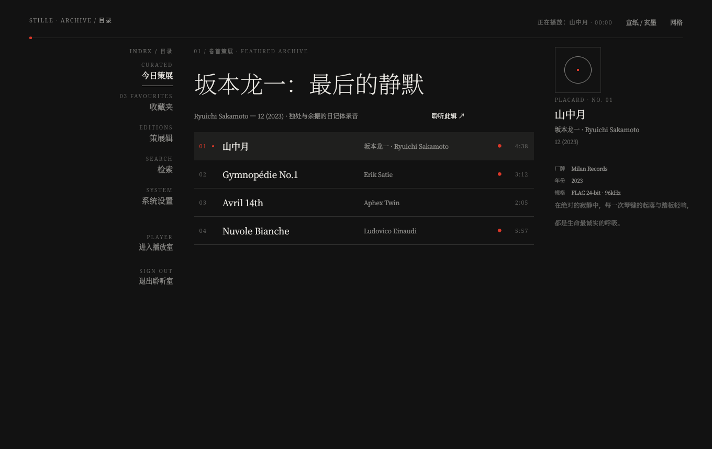
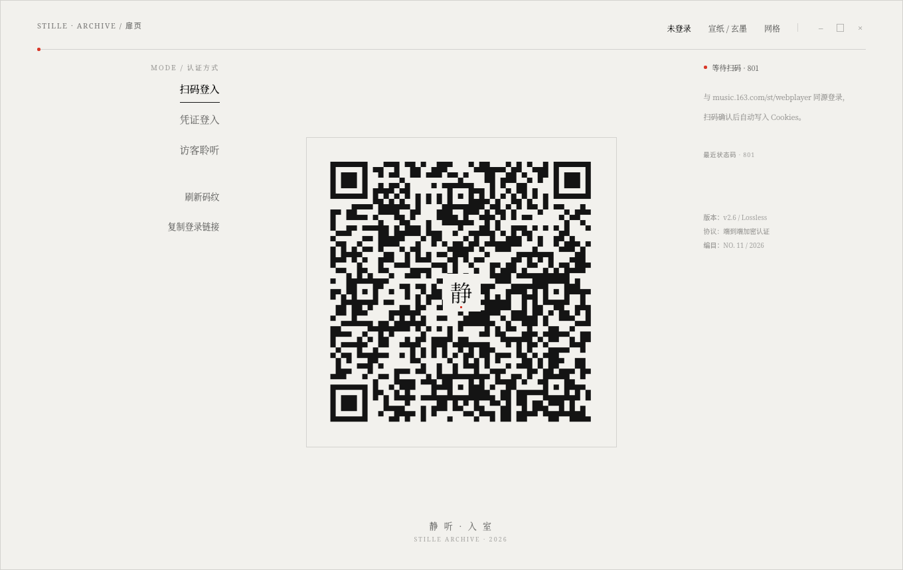
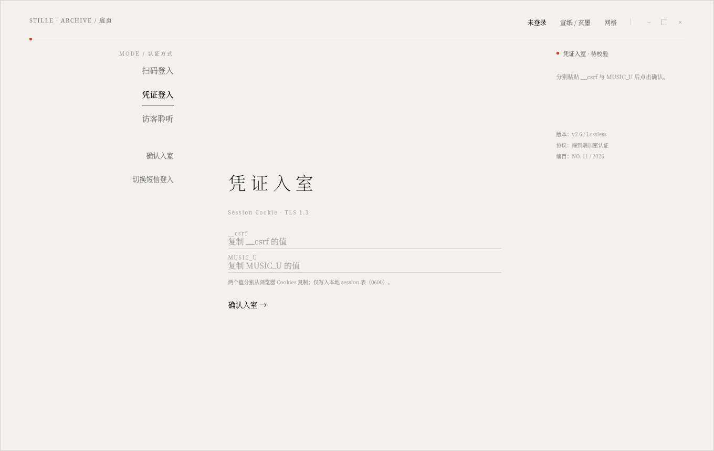

# sparkmusic-core

Qt-facing core library for SparkMusic, written in **Rust** and exposed to C++/QML
as a `QObject` through [CXX-Qt](https://github.com/KDAB/cxx-qt).

It owns the protocol layer of the recovered NetEase Cloud Music API — the same
**1,293-route catalog** used by `../python` (Python) and
`../api` (Rust/Axum) — and presents it as Qt invokables, so a Qt app
can call the service without any Python or HTTP glue of its own.

```cpp
SparkMusicClient client;                     // QObject from cxx-qt
qInfo() << client.routeCount();              // 1293
QString songs = client.searchSongs(QStringLiteral("海阔天空"), 10, 0);
QString url   = client.songUrl(QStringLiteral("347230"), QStringLiteral("exhigh"));
```

## Status

First working slice:

* eapi / weapi / linuxapi / plain-api envelopes (AES-128, MD5, RSA) in Rust
* blocking transport (ureq + rustls), cookie and CSRF handling, app defaults
* embedded 1,293-route catalog with prefix/version-tolerant lookup
* `SparkMusicClient` QObject with catalog, music and session invokables
* 36 Rust tests + a C++ smoke consumer built with CMake

Not there yet: async/signals, `QAbstractListModel`s for songs/playlists, a QML
module, and playback. See “Roadmap”.

## Requirements

* Rust 1.85+ (edition 2021)
* Qt 6.5+ (built and verified against **Qt 6.11.2** from `../qt611`)
* A C++20 compiler and CMake ≥ 3.21 for C++ consumers

## Build and test

```console
$ ./build.sh build        # cargo build (library only)
$ ./build.sh test         # 36 unit tests
$ cmake -S . -B build -G Ninja \
    -DCMAKE_CXX_COMPILER=/usr/bin/g++ \
    -DCMAKE_PREFIX_PATH=<path-to-qt6>
$ cmake --build build     # produces build/libsparkmusic_core.so.0
```

`build.sh` exists because this host mounts `/home` read-only (so `~/.cargo` and
ccache caches cannot be written). It sets `CARGO_HOME` to the shared registry
cache and `CCACHE_DISABLE=1`. On a normal machine, plain `cargo build` works if
`QMAKE`/`CMAKE_PREFIX_PATH` point at your Qt.

`SPARKMUSIC_EAPI_BASE`, `SPARKMUSIC_WEAPI_BASE`, `SPARKMUSIC_API_BASE` and
`SPARKMUSIC_LINUXAPI_BASE` override the upstream hosts (mirrors, or a local
mock during testing); unset means the built-in NetEase endpoints.

The build produces:

| Artifact | Purpose |
|---|---|
| `target/debug/libsparkmusic_core.a` | Rust static archive (linked into the Qt library) |
| `build/libsparkmusic_core.so.0` | Qt-facing shared library (`cmake -S core -B core/build`) |
| `target/cxxqt/include/` | generated C++ headers (stable path for consumers) |

## Desktop GUI (Qt Quick)

`gui/` is the STILLE shell from the design reference: Swiss typographic layout,
paper/ink themes, 12-column grid overlay, three views (登陆扉页 / 音乐主页 /
沉浸播放页).

From the **repository root** (`gui/` is a sibling of `core/`; its CMake adds
`core/` as a subproject and links the resulting shared library):

```console
$ cmake -S gui -B gui/build -G Ninja \
    -DCMAKE_CXX_COMPILER=/usr/bin/g++ \
    -DCMAKE_PREFIX_PATH=/run/media/forge/889dc643-5963-4417-b219-508778766cc7/qt611/6.11.2/gcc_64
$ cmake --build gui/build
$ ./gui/build/sparkmusic
```

The GUI **dynamically links** the core: CMake links the Rust static archive
into a shared object (`gui/build/core/libsparkmusic_core.so.0`, soname versioned) and
`sparkmusic` only carries `NEEDED libsparkmusic_core.so.0`. Replacing that
library swaps the API implementation without relinking the shell:

```console
$ readelf -d gui/build/sparkmusic | grep NEEDED
 0x0000000000000001 (NEEDED)   共享库：[libsparkmusic_core.so.0]
$ ldd gui/build/sparkmusic | grep sparkmusic
 libsparkmusic_core.so.0 => .../gui/build/core/libsparkmusic_core.so.0
```

Headless rendering (used for the screenshots below):

```console
$ QT_QPA_PLATFORM=offscreen ./gui/build/sparkmusic --screenshot out.png --view player --theme ink
$ QT_QPA_PLATFORM=offscreen ./gui/build/sparkmusic --screenshot search.png --section search --query 海阔天空
```

Launch flags: `--view login|home|player`, `--section curated|favorites|collections|search|settings`,
`--theme paper|ink`, `--query <text>`, `--play <index>`, `--delay <ms>`, `--screenshot <file>`.

| | |
|---|---|
|  |  |
|  |  |

Everything below is fed by the API:

* **今日策展** loads the real 热歌榜 (`v6/playlist/detail`, full upstream
  window); **策展辑** loads 热歌榜 / 飙升榜 / 原创榜 on click
* **检索** calls `core.searchSongs()` and lists live results
* **播放** resolves `song/enhance/player/url/v1` and plays the stream through
  Qt Multimedia; **歌词** comes from `song/lyric/v1`, parsed from LRC with
  timestamps and highlighted as playback advances. The active line is kept at
  the vertical centre of the lyric stage, with the previous/next lines faded
  around it
* **封面** comes from the track's `al.picUrl` and fills the square placard
  (cropped with `PreserveAspectCrop`); local favourites/history have no stored
  cover, so the player resolves one through `v3/song/detail` by song id and
  falls back to the seal glyph when no image is available
* 收藏夹 needs account data, so it states the login requirement instead of
  showing fabricated favourites

### Window chrome

The shell is a **client-side window**: `Qt.Window | Qt.FramelessWindowHint`,
a `DragHandler` calling `startSystemMove()`, 6 px edge grabbers calling
`startSystemResize()`, and typographic minimize/maximize/close controls in the
top bar. A 1 px `pal.faint` hairline keeps the paper edge legible. The native
title bar (and its khaki colour) is gone; the top bar itself is the paper.

Top-right now shows only **正在播放/已暂停** plus the account and window
controls; the duplicated track title/time stays in the right placard. The
progress hit area is 22 px high (the visible rule stays 1 px).

### Motion system

Five restrained motions share one vocabulary (OutQuart/OutCubic, tiny
amplitudes, no bounce arcs) so the shell reads as one living edition rather
than a set of unrelated effects:

* **Typography Flow** — `gui/qml/LyricLine.qml` splits a line into CJK
  characters and Latin words. Delegates reveal from zero, then each token
  enters with `OutQuart` and an independent 24 ms delay
  (`t_i = t - iΔ`), moving 4 px upward. The current line starts with three
  offset low-opacity ghosts (a renderer-independent soft-focus halo) that
  fade as it sharpens, while the previous and next lines settle to lower
  contrast
* **Editorial Grid** — the overlay fades in/out over 420 ms when toggled;
  while playing, the 12 rules breathe on an 8.4 s sine; a track change nudges
  alternating columns by 2–3 px; the rule nearest the playhead briefly
  darkens; pausing settles every column to one static value
* **Archival Transition** — on a track change the old cover steps back
  (650 ms) while the new one enters from the right; the title re-sets over
  450 ms, artist over 550 ms and the quality block over 750 ms
* **Mechanical Transport** — `SwissButton` presses with a capped damped
  elastic (`x(t) = 1 - e^(-7t)cos(10t)`-like `OutElastic`, amplitude 0.10–0.12);
  labels leave left and re-enter from the right, 收藏 expands its letter
  spacing once, and the volume percentage rolls to its new value
* **Left transport rhythm** — every control now has a Latin eyebrow
  (PAUSE/NEXT/PREV/FAVORITE/LOOP/VOLUME/INDEX); hover adds a 180 ms paper wash,
  the active rule is 220 ms, and the volume slider sits below the right-aligned
  `VOLUME / 音量 / 68%` block instead of pushing `音量` to the grid's left edge
* **Lyrics edge & contrast** — 76 px paper-gradient masks fade the top/bottom
  of the lyric stage; non-current lines use `ink2`/`ink3` with 0.54–0.60
  opacity instead of the old near-invisible 0.30–0.46
* **Cover mount** — the 88 px placard has a 4 px paper matte plus a 1 px
  0.24-opacity ink hairline, so saturated covers stay inside the sheet
* **Page, section & list transitions** — login/home/player cross-fade over
  460 ms with a 12 px lift (the incoming view is raised above the outgoing
  one); the five index tabs slide their content 22 px in the direction of
  travel and fade it in over 440 ms, while tab labels color-settle in 220 ms;
  track rows enter with a 360/420 ms fade-and-rise and a 14 ms per-row
  stagger (capped at 280 ms); account-playlist rows gain a 180 ms hover wash
* **Analog Progress** — the red playhead glides linearly on a 980 ms
  interpolation, follows a drag with 90 ms of inertia, snaps in 180 ms on
  release, and leaves a fading echo that travels back to zero when the track
  changes. The hairline, fill and dot are the product's recurring mark

### Persistence (SQLite)

The core keeps a local database at `$XDG_DATA_HOME/sparkmusic/sparkmusic.db`
(default `~/.local/share/sparkmusic/sparkmusic.db`), created on first run with
WAL enabled:

| table | contents |
|---|---|
| `favorites` | song id, title, artist, album, duration, added_at |
| `plays` | play history snapshot (title/artist/album/duration) + timestamp |
| `settings` | theme / grid and anything else the UI wants to remember |
| `session` | the saved cookie jar (`MUSIC_U`, `__csrf`) |
| `cache` | playlist/lyric payloads with timestamps (6 h / 7 d TTL) |
| `search_history` | distinct queries with hit count and recency |

Behaviour wired into the shell:

* **收藏夹** — with a session it lists every account playlist (「我喜欢的音乐」
  is detected by `specialType == 5`, or by name as a fallback) and loads the
  selected one; without a session it shows only the local table
* **本地收藏** — the player's 收藏 control inserts/removes a row; the same page
  also lists the last 20 distinct plays under 最近播放 (with 清除历史)
* **会话** — a successful QR/SMS/Cookie login persists the jar; on startup the
  session is loaded and verified through `nuser/account/get`, so you stay
  signed in. The top-right corner shows **未登录** until the account is
  verified, then the nickname; clicking 未登录 opens 扉页, clicking the
  nickname opens 收藏夹
* **设置** — paper/ink theme and the grid overlay are stored on change and
  restored at launch
* **缓存** — `v6/playlist/detail` is cached for 6 h and `song/lyric/v1` for
  7 days; the settings tab shows entry count/size and can clear it. Playlist
  keys include a hash of the session's `MUSIC_U`, so an anonymous or
  risk-controlled empty answer can never hide an account's playlists, and only
  successful non-empty playlists are cached
* **我喜欢的音乐 / 大歌单** — the UI asks for the upstream cap (1000) so a
  liked playlist with 830 tracks comes back in full. `v6/playlist/detail`
  returns the `tracks` window when authenticated; when it only returns
  `trackIds` (anonymous/`specialType == 5`), the core hydrates the requested
  window through `v3/song/detail` in 200-id batches and concatenates the
  results in reading order
* **虚拟化大列表** — curated/account tracks render in a `ListView` with a
  header and a 1400px cache buffer, so 830 rows only instantiate the visible
  delegates (plus cache) instead of a `Repeater`/`Column`. The header is
  re-anchored with `positionViewAtBeginning()` when its implicit height grows
  after fonts/layout settle
* **搜索历史** — every successful search is recorded (deduped, most recent
  first); the search section shows up to 8 chips and a 清除 action
* **导出收藏** — `exportFavorites(path)` writes an extended M3U8
  (`#EXTINF` + song page URL, because CDN stream URLs expire); it falls back
  to `$XDG_MUSIC_DIR`, `~/Music`, then the data directory
* **Migration** — `PRAGMA user_version` plus guarded `ALTER TABLE` upgrades the
  `plays` table created by earlier builds

The database file is created with mode **0600** on POSIX systems because it
stores `MUSIC_U`.

If `$HOME` is read-only (as on this build host) the database falls back to
`XDG_DATA_HOME` and finally to an in-memory instance, so the app still runs —
just without persistence.

### Login (扫码 / 凭证 / 访客)

The 扉页 follows `stille.html`: three auth modes, a printing-seal QR plate
(crop marks, 「静」 seal, state overlay) and a status placard on the right.

* **扫码登入** mirrors the official `https://music.163.com/st/webplayer`
  login: `POST /api/login/qrcode/unikey` with `type: 3` on Windows/Linux
  (`type: 4` on macOS) → matrix rendered from
  `https://music.163.com/login?codekey=<unikey>` →
  `POST /api/login/qrcode/client/login` polled every 1 s with the same
  type/envelope. Codes 800/801/802/803 drive the overlay text; on 803 the
  transport reads `MUSIC_U`/`__csrf` from `Set-Cookie` and the JSON `cookie`
  field, persists the jar and enters the room. This replaces the old
  eapi/weapi `type: 1` flow that was often answered with **8821** after the
  phone confirmed the scan.
* **凭证登入** has two sub-modes: SMS (`sms/captcha/sent` +
  `login/cellphone`) and **two-field Cookie** login: separate `__csrf` and
  `MUSIC_U` inputs, combined into the cookie header, then `setCookie` ->
  `nuser/account/get` verification. A leading `MUSIC_U=`/`__csrf=` and
  anything after `;` are stripped, so pasting the bare value or a full cookie
  line both work. E-mail + password login was removed from the UI. Failures
  show the server's `code`/`message` instead of pretending to succeed.
* Keep the encrypted QR bodies to exactly `{key, type}` / `{type}`: adding a
  cache-busting `timestamp` makes the server answer **8821** and the code looks
  dead. Error 8821 is now documented here because it cost a debugging round.
* The unikey and the polls share **one envelope and type**: `login_qr_key`
  creates the key as `api`/`type: 3` (webplayer parity) and remembers both;
  `login_qr_check` polls with the same pair. Mixing envelopes or types per
  request made the server see two different clients.
* Before the first QR key the client bootstraps the same web identity as
  `api-enhanced`/`folia-major`: `register/anonimous` with the desktop client's
  `base64(deviceId + " " + cloudmusic_dll_encode_id(deviceId))` username, then
  seeds `MUSIC_A`/`NMTID` plus `os`/`appver`/`deviceId` cookies. The device id
  is 32 alphanumeric characters; `register/anonimous` answers 400 for a
  hex-only id. This anonymous identity is never persisted as a login.
* The QR key/check are safe to retry once after a transport/5xx failure
  (`qr_retryable`), matching both reference clients. No `X-Real-IP` or
  `X-Forwarded-For` is sent, so NetEase sees the real egress IP instead of the
  `127.0.0.1`/random-CN-IP header that upstream API-enhanced adds by default
  and folia-major has to strip (`withoutImplicitClientIp`).
* `nuser/account/get` answers **200 with `account: null`** when logged out, so
  the UI treats "code 200" as success only when `account.id` exists. Getting
  this wrong made the app claim a session it did not have.
* Login wrappers can return the cookie in the JSON body (`cookie` field)
  instead of `Set-Cookie`; `Transport::call_in` merges both, strips
  `Path`/`Domain`/`Expires`/`Max-Age` attributes, and every login route (typed
  wrappers, generic `call` and the SMS `callWithMode` path) persists the jar to
  the `session` table.
* NetEase user ids are 64-bit. QML keeps `userUid` as a `double`; narrowing it
  to `int` truncated large account ids and made a signed-in user look like
  “账户未就绪”.
* 8821 after 802 also happens when a session cookie for another account is
  still in the jar. The login page exposes **清除会话后扫码** and the home
  sign-out path now clears the jar (`clearCookies`) before returning to 扉页.
* Risk control can answer a QR poll with a `captchaId` instead of 801/802/803;
  the UI still shows the server message and keeps the plate valid instead of
  pretending the login failed.
* **访客聆听** enters without credentials.
* The rendered plate is machine-verified: decoding `login_qr_poll.png` with
  OpenCV returns `https://music.163.com/login?codekey=<unikey>`, so the centre
  「静」 seal does not break scanning.
* After login the app reads `nuser/account/get`, finds the user's
  `specialType == 5` playlist and lets 收藏夹 load 「我喜欢的音乐」.

Because login needs the cookie jar to survive across calls, the Rust client now
keeps one persistent `Transport` and merges every response's `Set-Cookie` into
it (`Transport::absorb_cookies`), exposing the result via `cookieHeader()`.





## Using it from C++ / CMake

```cmake
find_package(Qt6 REQUIRED COMPONENTS Core)

# Build the library first: cmake -S core -B core/build && cmake --build core/build
add_executable(myapp main.cpp)
target_include_directories(myapp PRIVATE ${SPARKMUSIC_CORE}/target/cxxqt/include)
target_link_libraries(myapp PRIVATE
    ${SPARKMUSIC_CORE}/build/libsparkmusic_core.so
    Qt6::Core pthread dl m)
```

```cpp
#include "sparkmusic-core/src/lib.cxxqt.h"

SparkMusicClient client;
client.setCookie(QStringLiteral("MUSIC_U=…; __csrf=…"));  // optional
client.setMode(QStringLiteral("weapi"));                  // eapi by default
const QString json = client.songDetail(347230);
```

A complete, buildable example lives in [`examples/cpp`](examples/cpp):

```console
$ ./build.sh build          # cargo archive
$ cmake -S . -B build -G Ninja -DCMAKE_PREFIX_PATH=<qt> && cmake --build build
$ cmake -S examples/cpp -B /tmp/smoke -G Ninja \
    -DCMAKE_CXX_COMPILER=/usr/bin/g++ \
    -DCMAKE_PREFIX_PATH=$PWD/../qt611/6.11.2/gcc_64
$ cmake --build /tmp/smoke && /tmp/smoke/smoke
appVersion: "9.6.30"
routes: 1293 groups: 150
search: {"code":200,"result":{"songCount":306,...
```

## Invokables

| Method | Route / purpose |
|---|---|
| `routeCount()`, `groupCount()` | catalog stats (offline) |
| `routeInfo(route)` | route metadata as JSON (offline) |
| `searchRoutes(query, limit)` | catalog search as JSON (offline) |
| `call(route, paramsJson)` | any of the 1,293 routes |
| `searchSongs(keyword, limit, offset)` | `v1/search/get` |
| `songDetail(id)` | `v3/song/detail` |
| `songUrl(ids, level)` | `song/enhance/player/url/v1` |
| `lyric(id)` | `song/lyric/v1` |
| `playlist(id, limit)` | `v6/playlist/detail` |
| `album(id)` | `album/{id}` |
| `artist(id)` | `artist/detail/dynamic/v2` |
| `songComments(id, limit, offset)` | `v1/resource/comments` |
| `mode()` / `setMode(mode)` | `eapi`, `weapi`, `api`, `linuxapi` |
| `setCookie(header)` / `cookieHeader()` | session cookie (`MUSIC_U`, `__csrf`) |
| `appVersion()` | `9.6.30` |

Every music call returns the upstream JSON as a `QString`. Failures return
`{"code": -1, "message": "…"}`, so Qt code never has to deal with exceptions.

## Layout

```text
src/lib.rs        cxx-qt bridge: #[qobject] type + invokables
src/crypto.rs     eapi/weapi/linuxapi envelopes (known-answer tests)
src/transport.rs  ureq client, payload building, cookies, defaults
src/catalog.rs    1,293-route catalog + lookup rules
src/error.rs      error → JSON mapping
assets/routes.json  exported from the recovered Python catalog
examples/cpp/     CMake + C++ consumer (smoke test)
build.rs          cxx-qt build script, stable header copy
```

## Verification

* `cargo test`: 36 passed — AES known answers (independent pycryptodome
  values), envelope shape, catalog counts, lookups, cookie/CSRF handling,
  body-cookie absorption and session-scoped cache keys
* C++ consumer: instantiates the QObject, reports `1293 / 150`, resolves
  `song/detail` to `v3/song/detail`, and a live `searchSongs("海阔天空")`
  returns `code: 200` with 306 hits

## Roadmap

1. **Async**: move calls onto a worker thread and emit `finished`/`failed`
   signals so the GUI thread never blocks.
2. **Models**: `QAbstractListModel` for search results, playlists and lyrics.
3. **QML**: register the module with `#[qml_element]` and ship a typed
   `SparkMusicClient` for QML.
4. **Session**: cookie persistence (0600 file) and QR login invokables.

Use only with accounts and content you are authorized to access.
