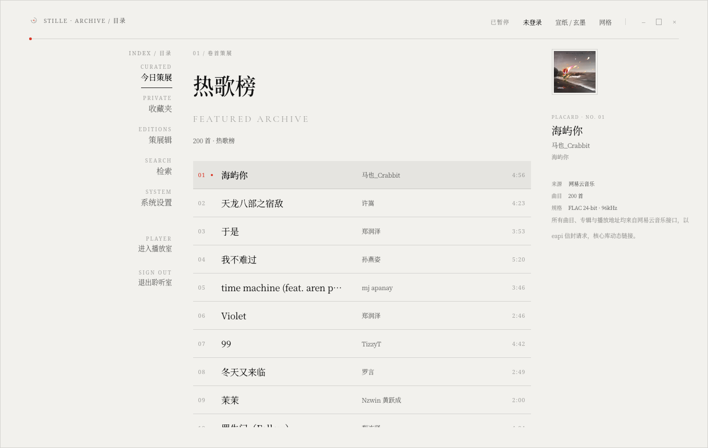

# sparkmusic-gui

The STILLE desktop shell: Qt Quick front-end, C++ `main.cpp`, and the cxx-qt
`SparkMusicClient` object injected as the `core` context property.

It **dynamically links** `libsparkmusic_core.so` — the shell owns no protocol
code, so replacing that library swaps the API implementation without touching
the UI.

## Build

From the repository root (`gui/` and `core/` are siblings):

```console
$ cmake -S gui -B gui/build -G Ninja \
    -DCMAKE_CXX_COMPILER=/usr/bin/g++ \
    -DCMAKE_PREFIX_PATH=/path/to/qt6
$ cmake --build gui/build
$ ./gui/build/sparkmusic
```

`gui/CMakeLists.txt` adds `../core` as a subproject, which builds the Rust
archive and links it into `libsparkmusic_core.so`; the executable then only
carries `NEEDED libsparkmusic_core.so.0`.

## Headless checks

```console
$ ./gui/smoke.sh          # build + cargo tests + dyn-link check + 3 screenshots
$ QT_QPA_PLATFORM=offscreen ./gui/build/sparkmusic \
    --screenshot out.png --view player --theme ink
```

Flags: `--view login|home|player`, `--section curated|favorites|collections|search|settings`,
`--theme paper|ink`, `--query <text>`, `--play <index>`, `--delay <ms>`,
`--login-mode sms|cookie`, `--demo-account`, `--login-after <ms>`, `--export`,
`--screenshot <file>`.

## Typography

| Role | Face |
|---|---|
| Chinese body/labels | **Noto Serif CJK SC** (思源宋体) |
| Chinese page titles (44 px) | Noto Serif CJK SC **SemiBold**, `Scale { xScale: 0.92 }` — a restrained 长体 treatment |
| Latin labels (9–11 px) | **Noto Serif** (kept for legibility at small sizes) |
| Latin display (≥18 px) | **Cormorant Garamond** (OFL-1.1), bundled under `gui/fonts/` as Latin-subset Regular/SemiBold and registered with `QFontDatabase::addApplicationFont` |

The four section headers now read `01 / 卷首策展` followed by a 18 px Cormorant
`FEATURED ARCHIVE` line (and `PRIVATE COLLECTION` / `ARCHITECTURAL EDITIONS` /
`SYSTEM LEDGER` for the other pages), which is where `serifDisplay` is used.



`type-specimen.png` compares 宋体/黑体 and a synthetic 长体, and
`type-cormorant-trial.png` shows why Cormorant is display-only: at 9–11 px its
small x-height made the metadata too faint, so small labels stay on Noto Serif.
